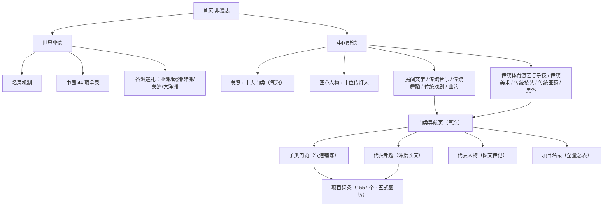

<div class="hero hero--slim hero--china">
  <div class="hero__body">
    <p class="hero__kicker">关于本志 · 结构与使用</p>
  </div>
</div>

<nav class="cat-rail">
  <span class="cat-rail__path"><a href="../">非遗志</a> › 关于本志 › 站点结构与使用</span>
</nav>

# 站点结构与使用

## 一、分支树（站点地图）



## 二、目录结构

```
Heritage-Wiki/
├── mkdocs.yml                 # 站点配置（导航在此，可手改）
├── README.md                  # 项目说明（含运行与编辑指南）
├── requirements.txt           # 站点依赖（mkdocs / material）
├── .github/workflows/deploy.yml  # 推送到 main 即自动发布到 GitHub Pages
├── serve.bat / serve.sh       # 一键本地预览
├── docs/                      # ← 全部内容（Markdown，改完即刷新）
│   ├── index.md               # 首页
│   ├── 世界非遗/               # 机制 · 中国44项 · 五洲巡礼
│   ├── 中国非遗/
│   │   ├── index.md           # 总览（十门类气泡）
│   │   ├── 匠心人物.md         # 十位传人汇总
│   │   └── <门类>/             # ×10
│   │       ├── index.md       #   门类导航页
│   │       ├── <子类>.md       #   子类门览（约 52 个）
│   │       ├── 项目名录.md     #   全量总表
│   │       ├── 项目/<名称>.md   #   词条 1557 个
│   │       └── 人物/<姓名>.md   #   匠人传记 10 篇
│   ├── 关于/                   # 编例 · 本页
│   ├── assets/img/            # 图像资产（大图/图版/气泡）
│   └── stylesheets/           # 设计系统（extra.css / heroes.css）
├── data/                      # 名录数据与内容配置
│   ├── projects.json          # 3610 条名录记录（结构化）
│   ├── taxonomy.json          # 1557 项 → 子类映射
│   ├── site_config.yaml       # 门类/子类规则与视觉记号
│   └── featured/<编号>.md      # 12 篇深度专题的「内容叠加」
└── tools/                     # 自动化脚本
    ├── fetch_ihchina.py       # 抓取官方名录
    ├── build_data.py          # 清洗与校验（1557/3610）
    ├── classify.py            # 子类分组
    ├── build_images.py        # 图版五式 + 气泡
    ├── gen_pages.py           # 生成词条/门览/名录（含专题叠加）
    └── gen_nav.py             # 生成导航
```

## 三、本地使用

```bash
# 双击 serve.bat（Windows）或运行 ./serve.sh，然后打开：
# http://127.0.0.1:8000
```

- 改内容：直接编辑 `docs/` 里的 Markdown，浏览器自动刷新；
- 改导航：编辑 `mkdocs.yml` 的 `nav:`，或运行 `python tools/gen_nav.py` 重新生成；
- 写深度专题：把正文写入 `data/featured/<项目编号>.md`（带 `hero_class` 等元信息），再运行
  `python tools/gen_pages.py --nums <编号>` —— 专题正文会自动注入词条页，同时保留全部子项数据与图版。

## 四、自动化工具一览

| 脚本 | 作用 |
| :-- | :-- |
| `tools/fetch_ihchina.py` | 从中国非物质文化遗产网抓取国家级名录全量数据 |
| `tools/build_data.py` | 清洗、去重、校验（输出 1557 项 / 3610 子项） |
| `tools/classify.py` | 按 `data/site_config.yaml` 规则把 1557 项分入门类子类 |
| `tools/build_images.py` | 绘制五式图版与全站气泡（`--sample/--only/--bubbles`） |
| `tools/gen_pages.py` | 生成全部词条页、子类门览、项目名录（`--force/--nums`） |
| `tools/gen_nav.py` | 依据配置生成 `mkdocs.yml` 完整导航 |

<p style="text-align:center;color:var(--ink-3);font-size:.8rem"><a href="../">← 返回编例与数据说明</a> ｜ <a href="../../README.md">项目 README</a></p>
